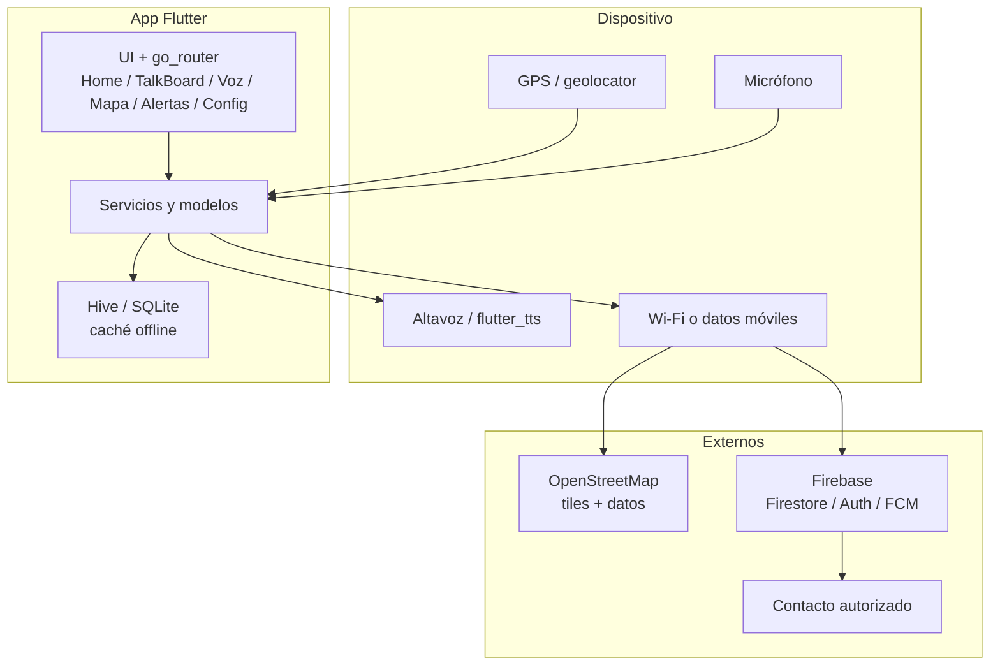

# Arquitectura y plan técnico — Geo Connect ESPOCH

**Versión:** 1.0 · **Fecha:** 27/11/2026 · **Responsable:** Cami  
**Asignatura:** Redes Inalámbricas y Móviles · **Carrera:** Telemática · **ESPOCH**

## 1. Visión

Aplicación móvil única en Flutter/Dart que reúne comunicación, orientación y asistencia inclusiva para personas con necesidades de accesibilidad en el campus de la ESPOCH. Aprovecha los recursos ya presentes en el celular (GPS, micrófono, altavoz, Wi‑Fi/datos móviles) sin dispositivos adicionales.

### Módulos acordados (nomenclatura única)

| # | Módulo | Función principal | Responsable |
|---|---|---|---|
| 1 | TalkBoard Connect | Pictogramas → frase → voz (`flutter_tts`) | Cami (UI) / Gaby (contenido) |
| 2 | Voz a texto | Micrófono → texto (`speech_to_text`) | Cami (UI) / Gaby (accesibilidad) |
| 3 | GeoESPOCH | Mapa OSM (`flutter_map`) + rutas accesibles | Anónimo |
| 4 | Alertas | Solicitud de ayuda con ubicación (Firestore + FCM) | Anónimo |
| 5 | Configuración | Permisos, contactos, preferencias de accesibilidad | Cami |

> Nota: el PDF original menciona “cuatro módulos y configuración” y además “rutas peatonales”. Se unifica en **5 módulos**, con las rutas dentro de GeoESPOCH.

## 2. Arquitectura general

### Capas

- **Presentación:** widgets de Flutter, navegación con `go_router`, `Semantics` para accesibilidad.
- **Dominio:** modelos (`Pictograma`, `Lugar`, `Alerta`, `Contacto`) y casos de uso.
- **Servicios:** `LocationService`, `SpeechService`, `TtsService`, `FirebaseService`, `ConnectivityService`.
- **Datos:** Hive para caché local; Firestore en la nube; OSM para cartografía.

## 3. Backlog priorizado

| ID | Historia de usuario | Criterios de aceptación | Prioridad | Responsable |
|---|---|---|---|---|
| HU-01 | Como estudiante, quiero abrir la app y ver un menú simple, para elegir el módulo que necesito. | 5 botones grandes (≥48dp), navegación funcional, etiquetas Semantics. | Alta | Cami |
| HU-02 | Como persona con dificultad para hablar, quiero seleccionar pictogramas y formar una frase, para comunicarme. | Cuadrícula de pictogramas, frase acumulada, botón “Reproducir” con TTS. | Alta | Cami/Gaby |
| HU-03 | Como usuario, quiero dictar y ver mi voz convertida en texto, para redactar sin escribir. | Permiso `RECORD_AUDIO`, transcripción en español, campo editable. | Alta | Gaby |
| HU-04 | Como estudiante, quiero buscar un edificio en el mapa, para saber dónde está y cómo llegar. | Marcadores OSM, ficha con descripción/coordenadas, ruta peatonal verificada. | Alta | Anónimo |
| HU-05 | Como usuario en riesgo, quiero enviar una alerta con mi ubicación, para que un contacto autorizado me ayude. | Confirmación antes de enviar, GPS incluido, estado enviado/en cola/fallido, FCM. | Alta | Anónimo |
| HU-06 | Como usuario sin internet, quiero ver el mapa y los lugares guardados, para orientarme igual. | Caché de tiles y datos; alerta queda en cola y se reenvía al volver la red. | Media | Anónimo |
| HU-07 | Como administrador, quiero gestionar contactos autorizados, para decidir quién recibe alertas. | Lista de contactos, alta/baja, reglas de seguridad Firebase. | Media | Anónimo |
| HU-08 | Como usuario, quiero ajustar tamaño de texto y alto contraste, para usar la app cómodamente. | Preferencias persistentes en Hive/Hive. | Media | Cami/Gaby |

## 4. Cronograma por fases

| Fase | Nombre | Entregables | Responsables |
|---|---|---|---|
| F1 | Levantamiento | PDF analizado, arquitectura, inventario de edificios y coordenadas verificadas | Cami + todos |
| F2 | Prototipo | Home + TalkBoard, STT/TTS, GeoESPOCH con OSM | Cami, Gaby, Anónimo |
| F3 | Integración | Firebase, alertas, conectividad, unión de módulos | Anónimo + Cami |
| F4 | Pruebas/Entrega | 15 casos de prueba, documento ESPOCH, README, APK | Gaby + Cami |

## 5. Matriz de trazabilidad

| Funcionalidad del PDF | Componente técnico | Evidencia | Responsable |
|---|---|---|---|
| TalkBoard Connect | `lib/modules/talkboard/`, `flutter_tts` | `docs/ui.md`, `docs/voz-accesibilidad.md` | Cami / Gaby |
| Voz a texto | `lib/modules/voice/`, `speech_to_text` | `docs/voz-accesibilidad.md` | Gaby |
| GeoESPOCH | `lib/modules/geo/`, `flutter_map`, `geolocator` | `docs/geo.md` | Anónimo |
| Solicitud de ayuda | `lib/modules/alerts/`, Firestore + FCM | `docs/firebase.md` | Anónimo |
| Rutas accesibles | Polylíneas en `flutter_map`, datos verificados | `docs/geo.md` | Anónimo |
| Configuración | `lib/modules/settings/`, Hive | `docs/proyecto-final.md` | Cami |
| Wi-Fi / datos móviles | `connectivity_plus`, cola offline | `docs/firebase.md` | Anónimo |
| Accesibilidad | `Semantics`, contraste, targets ≥48dp | `docs/qa.md` | Gaby |

## 6. Decisiones pendientes

1. **Package name de Android** — confirmar `com.example.geo_connect_espoch` antes de configurar Firebase.
2. **Proyecto Firebase** — quién crea el proyecto y quién tiene acceso de administrador.
3. **Contactos autorizados** — autenticación con Firebase Auth o lista local cifrada.
4. **Origen de los pictogramas** — ARASAAC u otro catálogo; verificar licencia y atribución.
5. **Rutas peatonales** — ¿cálculo automático (OSRM/GraphHopper) o polylíneas capturadas en campo?
6. **Caché offline** — Hive vs SQLite; definir expired de tiles y datos.
7. **Privacidad** — consentimiento explícito para ubicación y voz; retención de alertas.
8. **Publicación del tablero** — mantener privado con Gaby/Anónimo como colaboradores o hacerlo público.
9. **Límite de dependencias** — `firebase_messaging` y `speech_to_text` requieren permisos y pruebas en dispositivo real.
10. **Estrategia de merge** — PR a `develop`, `main` solo para entregables estables.
